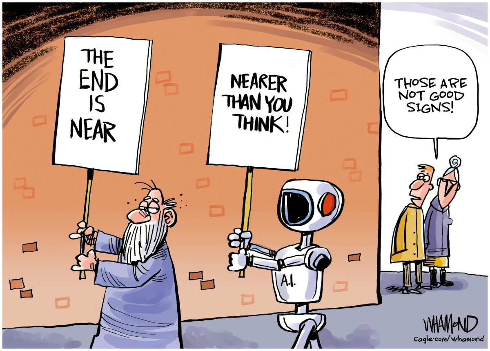
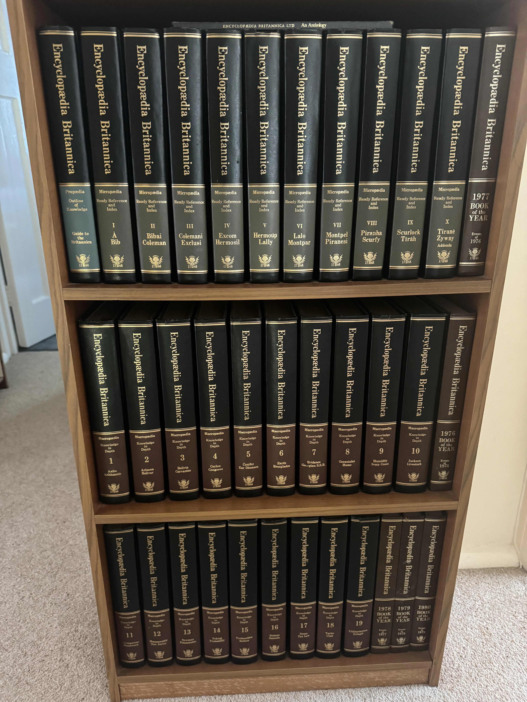

::: callout-note
## Objetivos de la sesión

Al terminar esta sesión deberíais ser capaces de:

- Explicar por qué no se puede evaluar un sistema de información sin conocer antes el contexto de la organización a la que sirve.
- Distinguir entre cuestiones **internas** y **externas** y entre **competencia directa** y **amenazas del entorno**.
- Interpretar lo que piden los apartados 4.1 y 4.2 de la ISO 9001:2026 y lo que **no** piden.
- Aplicar tres herramientas sencillas de análisis del contexto: PESTEL, DAFO y la matriz de poder e interés.
- Situar la vigilancia como el mecanismo que mantiene vivo el análisis del contexto.
:::

## ¿Qué es el contexto de la organización?

Para ello deberemos de irnos a la norma [ISO 9000](https://elrobin.github.io/aesde/lecturas/UNE-EN_ISO_9000=2026.pdf) donde aparecen las definiciones relacionadas con la gestión de la calidad y la [ISO 9001](https://elrobin.github.io/aesde/lecturas/UNE-EN_ISO_9001=2026.pdf) donde indica cómo auditar la calidad de una organización.

**Contexto**

: La organización debe determinar las **cuestiones externas e internas** que son pertinentes para su propósito y su dirección estratégica y que afectan a su capacidad para lograr los resultados previstos de su sistema de gestión de la calidad.

También indica que "la organización debe determinar si el cambio climático es una cuestión pertinente". Por último "debe realizar el seguimiento y la revisión de la información sobre estas cuestiones externas e internas".

Hasta ahora hemos mirado casi siempre **hacia dentro**:

- **Tema 1** - Describimos el sistema de información de la organizaicón
- **Tema 2** - Nos preguntamos por la calidad del sistema
- **Tema 3** - Auditamos el sistema contra la ISO 9001.
- **Tema 4** - El único momento en el que nos asomamos a otras organizaciones, aunque con el fin de comparar procesos, servicios y productos.

En este caso no se trata de medir una brecha con respecto a otras organizaciones que se toman de referencia, sino de identificar factores que puedan afectar a la organización tanto en positivo como en negativo.

En este sentido es importante tener en mente los siguientes aspectos:

1.  **Partes interesadas.** Identificar a las partes interesadas que son pertinentes para el sistema y comprender cuáles son sus necesidades y expectativas
2.  **Tiempo**. Tener en cuenta que las cuestiones internas y externas cambian con el tiempo.
3.  **Alcance**. En el caso de que una organización sea parte de una entidad mayor, delimitar los límites competenciales
4.  **Riesgo/Oportunidad**. Identificar los riesgos y oportunidades que se presentan y contrastarlos con las fortalezas y debilidades del sistema.

```{mermaid}
flowchart LR
    A["4.1 Contexto<br/>¿Qué nos afecta?"] --> C["4.3 Alcance<br/>¿Qué cubre el sistema?"]
    B["4.2 Partes interesadas<br/>¿A quién debemos responder?"] --> C
    C --> D["4.4 Procesos<br/>¿Cómo funciona?"]
    D --> E["6.1 Riesgos y<br/>oportunidades"]
    style A fill:#f5c518
    style B fill:#f5c518
```

> **¿Qué factores identificáis que puedan afectar a la biblioteca del Colegio Máximo?**

{fig-align="center" width="462"}

## Contexto externo e interno

### El caso de la Encyclopaedia Britannica

> ¿Sabéis qué es la *Encyclopaedia Britannica*?

+---------------------------------------------+--------------------------------------------------------------------------------------------------------------------------------------------------------------------------------------------------------------------------------------------------------------------------------------------------------------------------+
|                                             |                                                                                                                                                                                                                                                                                                                          |
+=============================================+==========================================================================================================================================================================================================================================================================================================================+
| {width="214"} | La *Encyclopaedia Britannica* se publicó por primera vez en Edimburgo en 1768. En marzo de 2012 anunció que dejaba de imprimirse después de **244 años**. Por entonces la edición impresa suponía menos del 1% de sus ingresos.                                                                                          |
|                                             |                                                                                                                                                                                                                                                                                                                          |
|                                             | La explicación habitual es que **la mató Wikipedia**, nacida en 2001. Pero en un artículo de *Wired* de 2012 titulado [*Wikipedia Didn't Kill Britannica. Windows Did*](https://www.wired.com/2012/03/wikipedia-didnt-kill-brittanica-windows-did/), sostiene que se trata de un error de cálculo que llegó mucho antes: |
|                                             |                                                                                                                                                                                                                                                                                                                          |
|                                             | - Microsoft había ofrecido a Britannica hacer una versión para ordenador en los años 80 que Britannica rechazó.                                                                                                                                                                                                          |
|                                             |                                                                                                                                                                                                                                                                                                                          |
|                                             | - En 1993, Microsoft lanzó su propia enciclopedia, **Encarta**, que se vendía en CD.                                                                                                                                                                                                                                     |
|                                             |                                                                                                                                                                                                                                                                                                                          |
|                                             | - Una vez la gente se acostumbró a consultar la enciclopedia a través del ordenador, la Britannica tenía ya sus días contados. Wikipedia llegó después.                                                                                                                                                                  |
|                                             |                                                                                                                                                                                                                                                                                                                          |
|                                             | Lo curioso es que la propia Encarta duró solo 17 años: Microsoft la cerró en 2009. El caso español sería la Espasa, otro viejo clásico de las casas.                                                                                                                                                                     |
+---------------------------------------------+--------------------------------------------------------------------------------------------------------------------------------------------------------------------------------------------------------------------------------------------------------------------------------------------------------------------------+

::: callout-important
## Lo que nos enseña Britannica

1.  **La amenaza no siempre es un competidor del mismo tipo.** Britannica se medía con otras enciclopedias impresas. El cambio vino de una **tecnología** (el ordenador personal) y de un **cambio social** (la información gratuita y colaborativa).
2.  **El entorno cambia más deprisa que la organización.** Doscientos años de éxito no protegen de veinte años de cambio.
3.  **La misma lógica se aplica a una biblioteca.** Si Britannica solo hubiera vigilado a otras enciclopedias, habría estado mirando en la dirección equivocada. ¿A quién vigila una biblioteca universitaria?
:::

### El caso de Kodak

En diciembre de 1975, un ingeniero de Kodak de 24 años, **Steven Sasson**, construyó la primera cámara digital autónoma. Pesaba 3,6 kilos, hacía fotos de 100 × 100 píxeles en blanco y negro y tardaba 23 segundos en guardar cada imagen en una cinta de casete.



*Inventor Portrait: Steven Sasson* (David Friedman, 2011). Unos tres minutos.

Pero Kodak vivía de vender carretes y revelarlos y vieron en la cámara digital una amenaza a su negocio.

> *\[M\]anagement' reaction was, that's cute -- but don't tell anyone about it.'*

En [este artículo](https://chunkamui.medium.com/how-kodak-failed-e1f929e12aa7) cuentan las razones por las que Kodak acabó fracasando y quebrando en 2012.

- A principios de los 80, Kodak encargó un estudio de mercado que concluyó que tenía unos diez años para prepararse para la fotografía digital. Identificó bien el factor externo
- En lugar de verlo como oportunidad, lo identificó como amenaza a su modelo de negocio.
- Cuando apostó por lo digital, llegó a liderar la venta de cámaras digitales en Estados Unidos en 2004 y 2005.
- En 2007 otra nueva tecnología, el *iPhone*, le comió la tostada otra vez.
- En enero de 2012 se declaró en quiebra. Ahora Kodak es mucho más pequeña y se dedica a la impresión comercial.

El problema no fue tanto la falta de información como la **incapacidad de la organización para actuar sobre ella**: su cultura, su modelo de negocio y sus incentivos. Es decir, **cuestiones internas**.

Las dos historias se complementan:

+---------------------------------+-------------------------------------------------------------+----------------------------------------------------+
|                                 | Britannica                                                  | Kodak                                              |
+=================================+=============================================================+====================================================+
| **Qué falló**                   | Mirar fuera en la dirección equivocada                      | Ver el cambio y no reaccionar                      |
+---------------------------------+-------------------------------------------------------------+----------------------------------------------------+
| **Tipo de cuestión**            | Sobre todo **externa**: tecnología, hábitos sociales        | Sobre todo **interna**: cultura, modelo de negocio |
+---------------------------------+-------------------------------------------------------------+----------------------------------------------------+
| **Pregunta para la biblioteca** | ¿Qué cambios fuera del sector pueden vaciar nuestras salas? | ¿Qué sabemos ya que no estamos usando?             |
+---------------------------------+-------------------------------------------------------------+----------------------------------------------------+

::: bonus
## La novedad: el cambio climático

Una de las grandes novedades de la ISO 9001:2026 es la inclusión de la frase **determinar si el cambio climático es una cuestión pertinente**. Y también cuando indica que las partes interesadas pertinentes **pueden tener requisitos relacionados con el cambio climático**.

**No** obliga a tener un plan climático ni a medir la huella de carbono. Solo obliga a **decidir si es pertinente** y a poder justificarlo.
:::

> ¿Qué tiene que ver el cambio climático con la Biblioteca del Colegio Máximo? ¿Es pertinente o no?

## Necesidades y expectativas de las partes interesadas

Tres ideas clave:

1.  **No hay que ser exhaustivo.** Solo lo que es *pertinente* y *afecta a los resultados*.
2.  **Hay cuestiones internas y externas, positivas y negativas.** El que sean positivas o negativas también depende de cómo se encaren.

| Contexto externo | Contexto interno      |
|------------------|-----------------------|
| Legal            | Dirección estratégica |
| Tecnológico      | Valores               |
| Competitivo      | Cultura               |
| De mercado       | Recursos              |
| Cultural         | Conocimientos         |
| Político         | Desempeño             |
| Social           |                       |
| Económico        |                       |
| Ambiental        |                       |

3.  **Es necesaria una vigilancia constante.** Lo que hoy puede no ser una oportunidad o amenaza, mañana sí, aquí es donde entra el concepto de **Vigilancia**.

### Definiciones de la ISO 9000

**Parte interesada**

: La persona u organización que puede **afectar**, **verse afectada** o **percibirse como afectada** por una decisión o actividad. La ISO 9001 pide determinar tres cosas:

a)  las partes interesadas que son **pertinentes** para el sistema de gestión de la calidad;

b)  los **requisitos pertinentes** de estas partes interesadas;

c)  **cuáles de estos requisitos se abordarán** mediante el sistema de gestión de la calidad.

El punto c) es importante: la organización no está obligada a atender todo lo que cada parte interesada quiera, pero sí a **decidir conscientemente** qué atiende y qué no. Y, tiene que hacer **seguimiento y revisión** de esta información, porque las partes interesadas y sus requisitos también cambian.

## Herramientas para analizar el contexto

Hay tres herramientas que casi todas las organizaciones emplean para analizar el contexto al tratarse de herramientas sencillas que y complementarias:

- **PESTEL** sirve para **ordenar el entorno externo**. Es una lista de comprobación que obliga a repasar todas sus dimensiones (política, económica, social, tecnológica, ecológica y legal) para no dejarse ninguna fuera.
- **DAFO** sirve para **cruzar lo externo con lo interno**. Toma las oportunidades y amenazas del entorno, muchas de ellas detectadas con el PESTEL, y las pone frente a las fortalezas y debilidades de la propia organización.
- **Matriz de poder e interés** que sirve para medir hasta qué punto ese factor **es prioritario o no en base a la parte interesada** a la que le afecta.

Dicho de otro modo: el PESTEL nos ayuda a ver qué pasa fuera, y la DAFO a decidir qué significa eso para nosotros.

### PESTEL

PESTEL es una lista de comprobación para no olvidarse de ninguna dimensión del entorno externo. Para cada dimensión nos hacemos una pregunta y buscamos qué factores concretos afectan a nuestra organización.

+-----------------+-------------------------------------------------------------+------------------------------------------------------------------------------------------------------------------------------------------------------+
| Dimensión       | Pregunta                                                    | Ejemplo                                                                                                                                              |
+=================+=============================================================+======================================================================================================================================================+
| **P**olítica    | ¿Qué decisiones de gobiernos e instituciones nos afectan?   | Una cooperativa de aceite ve cómo los aranceles de un país importador encarecen sus exportaciones y la obligan a buscar otros mercados               |
+-----------------+-------------------------------------------------------------+------------------------------------------------------------------------------------------------------------------------------------------------------+
| **E**conómica   | ¿Cómo evolucionan costes y presupuestos?                    | Una inmobiliaria pierde compradores cuando la subida de los tipos de interés encarece las hipotecas                                                  |
+-----------------+-------------------------------------------------------------+------------------------------------------------------------------------------------------------------------------------------------------------------+
| **S**ocial      | ¿Cómo cambian los hábitos y la composición de la población? | Una farmacia de barrio recibe más demanda de servicios como la medición de la tensión o la entrega a domicilio por el envejecimiento de la población |
+-----------------+-------------------------------------------------------------+------------------------------------------------------------------------------------------------------------------------------------------------------+
| **T**ecnológica | ¿Qué tecnologías cambian la forma de producir o consumir?   | Una agencia de traducción recibe menos encargos de traducción y más de revisión por la traducción automática con IA                                  |
+-----------------+-------------------------------------------------------------+------------------------------------------------------------------------------------------------------------------------------------------------------+
| **E**cológica   | ¿Qué condiciones ambientales nos afectan?                   | Una estación de esquí tiene que depender de la nieve artificial o buscar actividades de verano porque los inviernos traen menos nieve                |
+-----------------+-------------------------------------------------------------+------------------------------------------------------------------------------------------------------------------------------------------------------+
| **L**egal       | ¿Qué normas nos obligan?                                    | Una plataforma de alquiler vacacional ve limitada su oferta por las restricciones municipales a los pisos turísticos                                 |
+-----------------+-------------------------------------------------------------+------------------------------------------------------------------------------------------------------------------------------------------------------+

Si comparáis el PESTEL con la lista de la norma, veréis que la ISO 9001 incluye tres dimensiones que el PESTEL no tiene: lo **competitivo**, lo **de mercado** y lo **cultural**. PESTEL mira el entorno general, pero no a quién compite con nosotros.

### DAFO

La DAFO (en inglés, SWOT) cruza las dos dimensiones del 4.1:

|             | **Positivo**      | **Negativo**    |
|-------------|-------------------|-----------------|
| **Interno** | **F**ortalezas    | **D**ebilidades |
| **Externo** | **O**portunidades | **A**menazas    |

Es la herramienta más usada y la que más se usa **mal**. Dos errores típicos:

1.  **Confundir interno y externo.** «Hay mucha competencia» no es una debilidad, es una amenaza. «No tenemos personal formado en datos» no es una amenaza, es una debilidad.
2.  **Quedarse en la lista.** Una DAFO solo sirve si después se cruzan los cuadrantes: ¿qué fortaleza nos permite aprovechar esta oportunidad?, ¿qué debilidad nos deja expuestos a esta amenaza? Ese cruce es lo que la ISO 9001 llama, en el apartado 6.1, **riesgos y oportunidades**.

### La matriz de poder e interés

Una vez hemos identificado los factores del entorno (PESTEL y lo hemos calificado con respecto a la organización (DAFO), toca priorizar con respecto a las partes interesadas que hemos identificado. Una forma clásica es la de cruzar dos preguntas: **¿cuánto poder tiene sobre nosotros?** y **¿cuánto le interesa lo que hacemos?**

+-----------------+--------------------------------------------------------------------------------------+------------------------------------------------------------------------+
|                 | **Poco interés**                                                                     | **Mucho interés**                                                      |
+=================+======================================================================================+========================================================================+
| **Mucho poder** | **Mantener satisfecha.** Puede afectarnos mucho aunque no esté pendiente de nosotros | **Gestionar de cerca.** Implicarla en las decisiones                   |
+-----------------+--------------------------------------------------------------------------------------+------------------------------------------------------------------------+
| **Poco poder**  | **Seguimiento mínimo.** Vigilar por si cambia de posición                            | **Mantener informada.** Suele ser buena aliada y fuente de información |
+-----------------+--------------------------------------------------------------------------------------+------------------------------------------------------------------------+

::: {.callout-note collapse="true"}
## Caso: la Universidad de California contra Elsevier

*¿Quién tiene más poder sobre una biblioteca universitaria: sus usuarios o sus proveedores?*

- En febrero de 2019, la Universidad de California **canceló sus suscripciones a Elsevier** después de meses de negociación. Pagaba unos 11 millones de dólares al año, el 25% de su gasto en revistas. Pedía dos cosas: bajar costes y que todo lo que publicaran sus autores en Elsevier fuera en **acceso abierto** por defecto.

- Elsevier ofreció algo parecido, pero con un aumento de los pagos del 80%.

La negociación movilizó a muchas partes interesadas:

- **El proveedor** (Elsevier), con un poder enorme: controlaba el acceso a revistas imprescindibles.
- **El profesorado**, a través de su Senado Académico, que había fijado los principios de acceso abierto. Parte del profesorado dejó de revisar para revistas de Elsevier.
- **Los usuarios** (estudiantes e investigadores), que se quedaban sin acceso directo a lo nuevo.
- **Otras universidades y consorcios**, que miraban el caso como precedente. Las alemanas ya habían cancelado antes por el mismo motivo.

En marzo de 2021, las dos partes firmaron un acuerdo de acceso abierto.

**Para pensar:** ¿dónde colocaríais a cada una de estas partes interesadas en la matriz? ¿Cambió su posición durante el conflicto?
:::

## La vigilancia

Para **hacer seguimiento y revisar** la información sobre el contexto se suelen emplear técnicas de **vigilancia**, que conviene distinguir de la **inteligencia**:

+----------------------+------------------------------+---------------------------------------+
|                      | Vigilancia                   | Inteligencia                          |
+======================+==============================+=======================================+
| **Actitud**          | Más pasiva: captar y filtrar | Activa: analizar y recomendar         |
+----------------------+------------------------------+---------------------------------------+
| **Punto de partida** | Un área que interesa vigilar | Un problema o una decisión concreta   |
+----------------------+------------------------------+---------------------------------------+
| **Resultado**        | Información seleccionada     | Información interpretada para decidir |
+----------------------+------------------------------+---------------------------------------+

La vigilancia tiene distintos tipos (tecnológica, competitiva, comercial, jurídica, del entorno…) y un ciclo propio: identificar necesidades, buscar, analizar, difundir y usar. Todo eso se trabaja a fondo en la optativa [**Vigilancia Tecnológica e Inteligencia Competitiva**](https://www.ugr.es/estudiantes/grados/grado-informacion-documentacion/vigilancia-tecnologica-inteligencia-competitiva/guia-docente).

Volvamos a la pregunta del principio:

> **¿Qué factores identificáis que puedan afectar a la biblioteca del Colegio Máximo?** Distingue entre *amenazas* y *oportunidades.*

## Tarea

::: ejercicio
**No hace falta buscar información nueva.** En vuestra web ya tenéis buena parte del material: la Carta de Servicios, la Estrategia BUG 2024–2031, el Mapa de Alianzas, el CBUA, REBIUN… Se trata de **reordenarlo** con las herramientas de hoy.

**1. Cuestiones del contexto.** Una tabla de **5 filas como máximo**:

+-------------+-------------------+------------------------------+-----------------------------------------------+
| Cuestión    | Interna o externa | Dimensión (PESTEL o interna) | ¿Fortaleza, debilidad, oportunidad o amenaza? |
+=============+===================+==============================+===============================================+
|             |                   |                              |                                               |
+-------------+-------------------+------------------------------+-----------------------------------------------+

Al menos una cuestión tiene que referirse a un **competidor que no sea una biblioteca**.

**2. Cambio climático.** Un párrafo: ¿es una cuestión pertinente para la biblioteca? Decidid sí o no y justificadlo. Las dos respuestas son válidas si están bien argumentadas.

**3. Partes interesadas.** Una tabla de **5 filas como máximo**:

+------------------+----------------------------------------------------+-------------------+---------------------+
| Parte interesada | Requisito pertinente ¿Qué espera de la biblioteca? | Poder (alto/bajo) | Interés (alto/bajo) |
+==================+====================================================+===================+=====================+
|                  |                                                    |                   |                     |
+------------------+----------------------------------------------------+-------------------+---------------------+

Al menos una parte interesada **no** puede ser usuaria de la biblioteca.

**Antes de dar la tarea por terminada**, comprobad:

- [ ] ¿Cada celda tiene una justificación de una frase, no un párrafo?
- [ ] ¿Ninguna cuestión interna aparece como amenaza u oportunidad, ni ninguna externa como fortaleza o debilidad?
- [ ] ¿Cada fila tiene una fuente identificable (autor o institución, fecha y enlace)?
- [ ] ¿La tabla de cuestiones incluye al menos un competidor que no sea una biblioteca?
- [ ] ¿Hay al menos una parte interesada que no sea usuaria?

**Entrega.** Commit al repositorio antes de que acabe la clase.
:::
